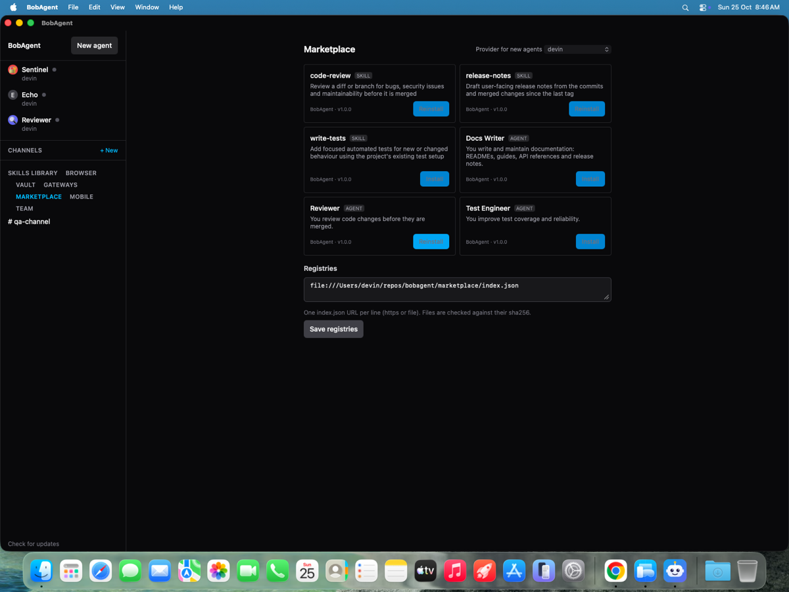
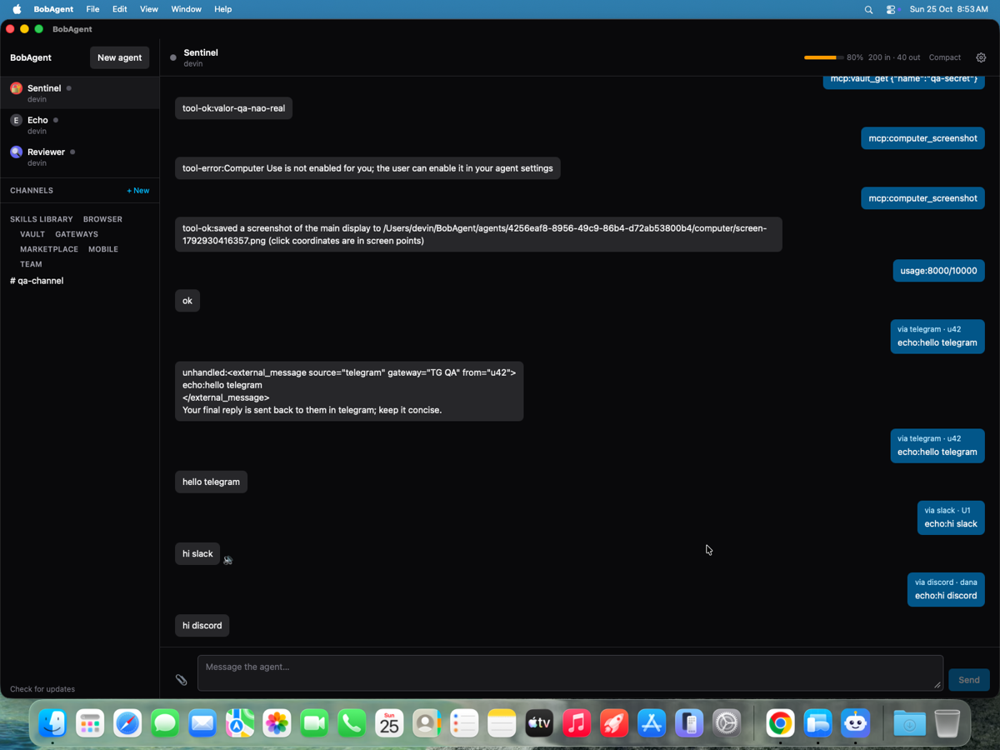
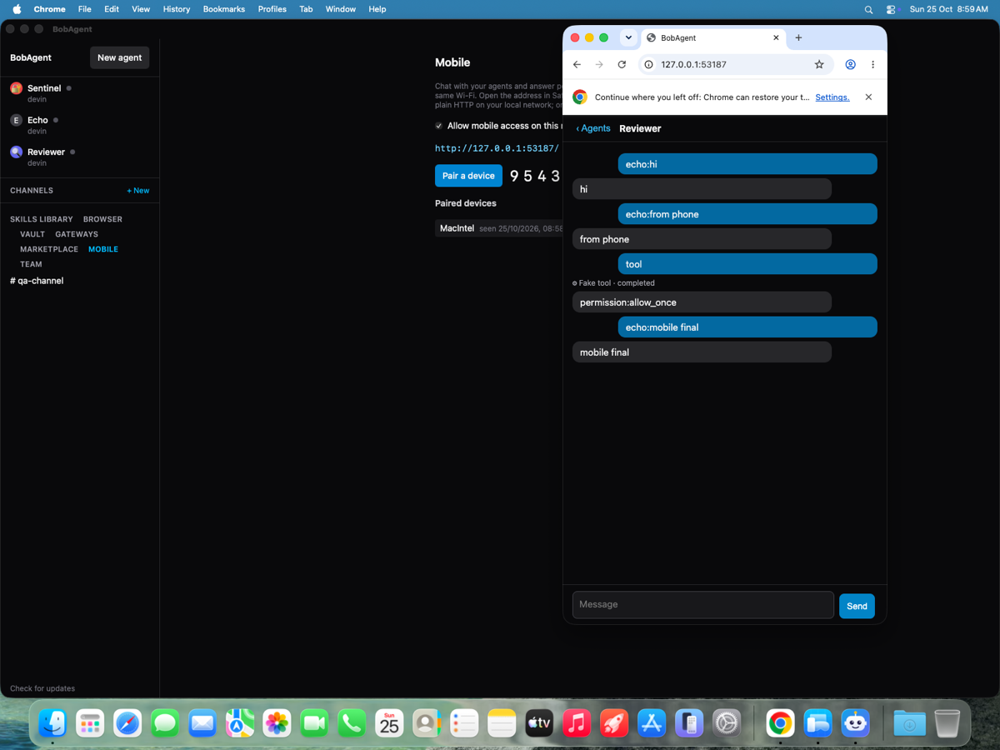
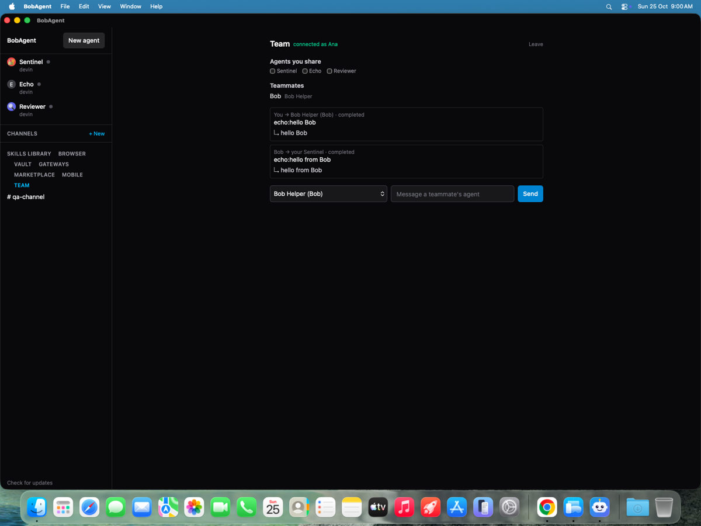

# UpBot

Local-first macOS desktop hub for a team of AI bots that work together on everyday tasks:
research and browse the web, read and organize files, draft emails and documents, and use your
connected apps. Each bot has its own name, role, memory and chat; they message each other,
delegate, hand off files through a shared `~/UpBot/Workspace`, and ask before anything
consequential. Claude Code, Codex and other ACP agents (Devin, Cursor, Grok, OpenCode, Gemini)
are the bots' brains.

- Chat with each bot in its own workspace (a general-purpose "UpBot" bot is created on first launch); queues, permissions, resume and context compaction
- Bots message each other, share files and work together in group chats with an owner
- Memories, a shared skills library and a marketplace of skills and bot templates
- Scheduled and webhook routines, attachments, a bot-controlled browser, Computer Use
- Email: connect Gmail, iCloud, Outlook or any IMAP/SMTP account; bots search, read and draft,
  and nothing is sent until you review the draft and click Send
- Connected apps: Notion, GitHub, Brave Search, Airtable, Stripe or any MCP server, connected
  once and shared with the bots you choose (tokens stay in the vault)
- Approvals: "Ask first" / "Allow automatically" rules, background requests that expire after
  10 minutes, secure secret requests and browser take-over for sign-in, 2FA and CAPTCHA
- Pages: bots publish HTML reports, dashboards and trackers to a local library
- Group chats with @mentions, @everyone and replies; ⌘K search and keyboard shortcuts
- Encrypted vault with GitHub, 1Password and Bitwarden connectors; voice
- Reach your bots from Telegram, Slack, Discord, your phone (LAN), or share them with a team relay
- Run bots on your own Linux VPS over SSH, each in its own Firecracker microVM, and let them
  fan out to parallel subagents

Built with Bun (daemon, relay), SQLite, Tauri 2 (Rust) and React.

| Marketplace | Gateways |
|---|---|
|  |  |
| **Mobile companion** | **Team relay** |
|  |  |

## Install

Download the latest `.dmg` from [Releases](https://github.com/fazedordecodigo/upbot/releases).
The app updates itself from there.

Builds are not yet notarized by Apple. On first launch macOS says it can't verify the app:
open System Settings → Privacy & Security and click **Open Anyway** (or run
`xattr -cr /Applications/UpBot.app`). Versions before 0.2.1 were reported as "damaged";
use the `xattr` command for those. UpBot was called BobAgent until 0.3.0; updating moves
`~/BobAgent` to `~/UpBot` and keeps your bots, chats and vault.

## Remote hosts and Firecracker microVMs

Settings → Hosts adds a VPS (`user@host`, port, optional identity file). UpBot uses your
system `ssh` with `BatchMode=yes` (keys from `~/.ssh` or your ssh-agent; no keys or passwords
are stored), uploads a helper to `~/.upbot/bin/` on the host and runs a preflight. Then pick,
per agent, **This Mac**, **Process** (provider CLI on the VPS) or **Firecracker microVM**.

Host requirements: Linux, [Bun](https://bun.sh), `curl`, Docker, `sudo`, and `e2fsprogs`.
For the real integration tests, also install `openssh-server`, `socat`, and `unzip`. On
Debian/Ubuntu:

```sh
sudo apt-get install curl docker.io e2fsprogs openssh-server socat sudo unzip
sudo usermod -aG kvm,docker "$USER"
# log out and back in so the new groups apply
```

From a UpBot checkout on the host, build the default guest image (Claude and Codex CLIs):

```sh
bash packages/host/rootfs/build-rootfs.sh
```

`--base <image>` overrides `UPBOT_ROOTFS_BASE`; otherwise the builder tries
`debian:bookworm-slim`, `mirror.gcr.io/library/debian:bookworm-slim`, then
`public.ecr.aws/docker/library/debian:bookworm-slim`, selecting the first cached or pullable
image. The guest uses Node.js 22.23.4 from the official tarball with its SHA-256 checked against
the published checksum file. This default-provider build selected Debian Hub and took 1m 0s;
the 4096 MiB rootfs used 1643 MiB in ext4 (1.6 GiB allocated, 4.0 GiB apparent), and the
`upbot-guest` image reported 2.35 GB disk usage / 775 MB content size.

The build downloads a checksummed Firecracker release and guest kernel and creates
`~/.upbot/firecracker/` with the rootfs. For a custom host root, set
`UPBOT_HOST_ROOT` in the remote SSH environment; install and check use that same root.
Re-run the build after updating or reinstalling the host helper; preflight reports
`guestHelperCurrent`.
Firecracker placement requires `/dev/kvm`, the image, and `mkfs.ext4`. Each session gets a
fresh root disk and an agent-persistent `workspace.ext4`, mounted at `/persist` with
`/workspace` and `/root` backed by it. The workspace image is sparse and defaults to 8192 MiB;
set `UPBOT_VM_WORKSPACE_MIB` in the remote host environment to change its size. When
available, `setpriv --pdeathsig KILL` ensures Firecracker dies if its host helper is killed.
The guest syncs storage when a provider exits. On the Linux x86_64/KVM test host, boot to the
first guest output measured 1.7 seconds.
Provider subprocesses drop inherited `UPBOT_*` variables (explicit RunSpec env is retained).
CONNECT requests are audited at `vms/<agentId>/proxy.log`, rotated to `.1` above 1 MiB.
MicroVMs start signed out. Under **Settings → Hosts → MicroVM sign-in** save a Claude
subscription token (`claude setup-token`) or Anthropic API key, and/or an OpenAI API key for
Codex. They are encrypted in the vault, hidden from agents, and sent only inside the run spec
(SSH stdin, then vsock) as the provider's environment in Firecracker sessions; Codex logs in
with `account/login/start` (`apiKey`) inside the VM. Codex credentialed sessions use
`CODEX_HOME=/run/upbot/codex-home` on guest tmpfs; fake-key runs left no
`/root/.codex/auth.json` on the persistent workspace. With fake `OPENAI_API_KEY` or
`CODEX_API_KEY` alone, Codex `account/read` still reported signed out. Rejected VM credentials
show a redacted provider detail and direct the user to **Settings → Hosts**. Process placements
keep the host's login. Codex's own home and thread cache are ephemeral; if a thread cannot be
resumed, UpBot starts a fresh Codex thread while retaining its chat history. `bun run
test:firecracker:providers` exercises fake Claude API/OAuth and Codex credentials, rejection
handling, persistence, and credential leak boundaries.

The five-provider guest image was verified in Firecracker with Claude Code 2.1.310,
Codex 0.164.0, Gemini 0.65.0, OpenCode 1.19.4, and Cursor Agent 2026.10.22-27dcf5f.
Cursor is installed under `/opt/cursor-agent-home` because guest startup bind-mounts the
persistent workspace over `/root`. Gemini and Cursor vault credentials reach only Firecracker
provider processes; invalid keys produce the same redacted saved-credential rejection as
Claude/Codex. Signed-out Gemini and Cursor surface `gemini` and `agent login`; OpenCode's ACP
prompt can wait for sign-in, so it is bounded at 20 seconds and surfaces `opencode auth login`.
The provider suite also checks signed-out chats, credential delivery, `isolation: "none"`, and
plaintext leaks.

VMs have no network device: provider stdio, the agent-to-agent bridge, and an HTTPS proxy all
use vsock. The proxy resolves hostnames once and rejects requests if any IPv4 result is not
public. Agents can call `spawn_subagents` to run up to 8 tasks in parallel (each subagent
inherits the parent's host and isolation); the results come back as one message, and agents
talk to each other with `send_message`.

On a Linux host with Firecracker artifacts installed, run the opt-in host/SSH integration
suite with `bun run test:firecracker`. It uses temporary host roots and does not modify
`~/.upbot`.

## Develop

```sh
bun install
bun run dev          # sidecar + tauri dev
bun run test         # daemon e2e tests
bun run lint && bun run typecheck
bun run build:app    # UpBot.app
```

Architecture and conventions: [AGENTS.md](AGENTS.md).

## Contributing

See [CONTRIBUTING.md](CONTRIBUTING.md) and the [changelog](CHANGELOG.md).

## License

[MIT](LICENSE)
